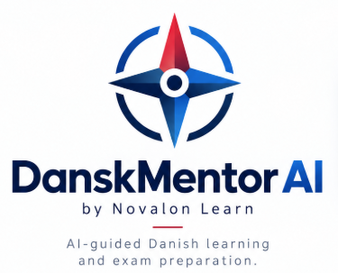

# DanskMentor AI Releases

AI-guided Danish learning and exam preparation.

by Novalon Learn

**31 October 2026: development preview, not ready for a general release. No installable packages have been published.** This repository preserves release documentation and completed engineering checkpoints. A completed audit or checkpoint is not a released software edition.

- [GitHub Releases](https://github.com/MiMat82/DanskMentor-AI-Releases/releases) — currently empty
- [Application source repository](https://github.com/MiMat82/DanskMentor-AI) — access required
- [Latest audit checkpoint](manifests/full-audit-2026-10-31-checkpoint.json)
- [Release policy](RELEASE_POLICY.md) · [Unpublished manifest example](manifests/release-manifest.example.json)

| Target | Current availability |
| --- | --- |
| Windows desktop | Local engineering build; no installer or public download |
| Browser / WebAssembly | Local engineering build; no public deployment |
| Android APK / AAB | No package published or device qualification |
| iOS IPA | No package published or device qualification |

## What works in the development build

The interface and backend use Rust, with Dioxus, Axum and bundled SQLite. **Create account** and **Switch user** support multiple people on one computer, with separate saved learning. Persistence was checked across service restarts. Local GGUF tutoring, explicit recording, local Whisper transcription and feedback on user-reviewed transcript text are implemented. AI and transcription require configuration and are disabled by default. Tutoring also requires an independently reviewed published lesson; no approved curriculum is bundled.

The 31 October audit used isolated fictional accounts and test audio, with these results:

| Verification | Result |
| --- | --- |
| Rust workspace tests, including desktop capture regressions | 149 passed |
| Formatting and strict Clippy | Passed |
| Baseline browser workflows: accounts, restart, learning, civic demos and staff | 64 passed |
| Real local GGUF tutor workflow | 21 checks passed; teaching-quality issues remain |
| Speaking workflow | 18 + 3 + 5 passing checks across separate retained runs and harness corrections; not one clean end-to-end run |
| Real Whisper cancellation | Child process stopped and temporary job files removed before acknowledgement |
| Native embedded service and account persistence | 3 checks passed; API-level, not complete native UI verification |
| Route / tab / viewport inventory | 98 snapshots; inventory is not proof that every button works |
| Accessibility | 42 scans completed; every scan found violations |
| Fresh dependency audit | No vulnerability-category or yanked entries; five informational advisories, so `--deny warnings` failed |

## Why there is no downloadable release yet

- **Saved data and preview:** saving Profile/Settings can overwrite newer unsaved edits. Preparing a demo exam in design preview creates a saved account attempt, and preview can show account history. These were reproduced with fictional accounts; no cross-user disclosure was established.
- **Interface and accessibility:** phone Library overflow, delayed System theme changes, missing document language, invalid sidebar ARIA, avatar contrast and an exam landmark defect remain.
- **AI and speech:** generated follow-up activities can refer to unsupported lesson material. A repeated-speech fixture lost most repetitions during transcription. Pronunciation and fluency assessment are not qualified; saved tutor history is not conversational memory.
- **Learning and exams:** course links lead to a grocery demonstration. Civic exam flows use synthetic arithmetic questions; PD1, PD2 and PD3 and reviewed course packs are not available. Several audio, progress and search features remain incomplete.
- **Accounts, service and distribution:** password recovery, full account deletion and backup/restore deletion replay are unfinished. Native service instance/version binding and whole-app speech shutdown need work. Physical microphones, complete native UI, clean-machine installation, signing and mobile packages remain unqualified.

The next release decision follows fixes for preview isolation and lost edits, accessibility and interface regressions, AI/speech qualification, reviewed content for the supported scope, then installation and distribution verification. Real exam pathways require separate completion before an exam-preparation edition. This audit changed no application code and rebuilt no binary. No app defect is marked fixed by this documentation update.

## Path to the first trustworthy edition

The proposed first edition is a **limited Windows learning preview**, with a small reviewed Danish course and explicitly supported local AI configurations. It will not claim complete exam preparation. All six gates remain open:

1. Fix preview isolation and loss of newer edits during saves; verify retries, switching and reopen.
2. Fix accessibility, phone layout and theme behavior; test keyboard navigation, screen readers and every supported control.
3. Deliver distinct approved lessons and a complete course journey, with documented content rights and review.
4. Qualify AI answers and suggested activities. Fix and test speech on real microphones or keep it outside the supported release.
5. Complete account recovery, backup/restore and deletion behavior, plus compatible service startup and shutdown.
6. Build a versioned Windows installer and verify clean installation, existing-user upgrades, licenses, dependency findings, signing status and final checksums.

The [detailed release plan](https://github.com/MiMat82/DanskMentor-AI/blob/main/docs/novalon/FIRST_RELEASE_PLAN.md) is in the private source repository. Complete PD/civic preparation, mobile packages and hosted web distribution require their own work and qualification. No release date is promised; the immediate coding priority is the two data-handling defects.

The [full report and evidence](https://github.com/MiMat82/DanskMentor-AI/blob/ddb32ce4dc0260e56bd2990ba4988492b80c48d5/docs/novalon/FULL_CHECK_2026-10-31.md) are in the private source repository and require access. The public checkpoint records the tested revision, build hashes and verification boundaries without learner data, credentials, model weights or recordings.

## Preserved engineering history

All entries below are **unpublished checkpoints**, not versioned downloads. Their results apply only to the recorded revisions.

| Checkpoint | Record |
| --- | --- |
| 31 October — full application, AI, speech and accessibility audit | [Audit results and outstanding blockers](manifests/full-audit-2026-10-31-checkpoint.json) |
| 28 October — recoverable Windows microphone callbacks and capture teardown | [Native capture fix](manifests/native-capture-checkpoint.json) |
| 28 October — separate username and password guidance | [Account field guidance](manifests/account-field-guidance-checkpoint.json) |
| 28 October — multiple local accounts and SQLite persistence | [Local accounts](manifests/local-accounts-checkpoint.json) |
| 27 October — local GGUF tutor | [Tutor checkpoint](manifests/local-gguf-tutor-checkpoint.json) |
| 26 October — initial Rust interface and service | [Rust checkpoint](manifests/rust-engineering-checkpoint.json) |

Each future release must identify its actual files, source revision, SHA-256 checksums, supported platforms, signing status and verification results. Earlier checkpoint records remain unchanged.

DanskMentor AI is an independent learning aid. It does not issue official examination certificates or imply government endorsement. Software attribution is recorded in [THIRD_PARTY_NOTICES.md](THIRD_PARTY_NOTICES.md).
